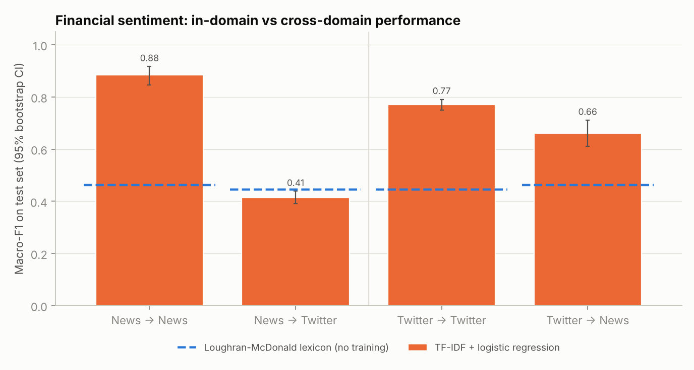
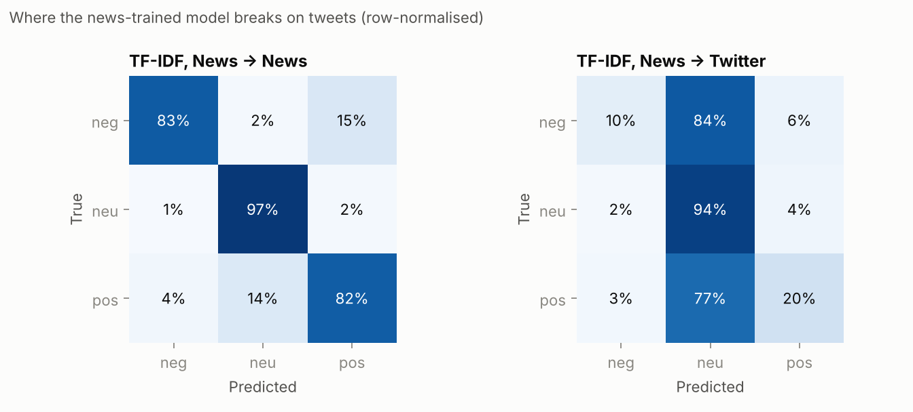

# Financial Sentiment NLP: Does a model trained on news understand finance Twitter?

Sentiment models for finance are usually trained on one kind of text and then
deployed on another. This project measures how much that costs. It trains
sentiment classifiers on **financial news sentences** and on **finance tweets**, then
tests each on both, comparing a finance-specific lexicon, a classical TF-IDF model
and fine-tuned transformers (DistilBERT and FinBERT).

## Data

| Domain | Dataset | Size | Labels |
|---|---|---|---|
| News | Financial PhraseBank, 100% annotator agreement subset (Malo et al., 2014) | 2,259 sentences (after de-duplication) | negative / neutral / positive |
| Twitter | Twitter Financial News Sentiment (zeroshot, 2022) | 11,892 tweets | bearish / neutral / bullish, mapped to the same three labels |

Splits are fixed (seed 42). PhraseBank uses a stratified 60/20/20 split. Twitter uses
its official validation file as the test set, with 15% of its training file held out
for model selection. URLs and `$CASHTAGS` are replaced by placeholder tokens.

## Models

| Model | Training |
|---|---|
| Loughran-McDonald lexicon | None. Positive minus negative finance words (Loughran & McDonald, 2011) |
| TF-IDF + logistic regression | Word 1-2 grams and character 2-5 grams. C and class weighting chosen on validation macro-F1 |
| DistilBERT | `distilbert-base-uncased`, fine-tuned with a plain PyTorch loop (AdamW, linear warm-up and decay, 4 epochs, best validation checkpoint) |
| FinBERT | `yiyanghkust/finbert-pretrain` (BERT further pre-trained on financial text), same fine-tuning recipe |

The FinBERT used here is the **pre-trained-only** checkpoint. The popular
`ProsusAI/finbert` model was itself fine-tuned on Financial PhraseBank, so using it
would leak test sentences into training.

## Results

Macro-F1 on each test set with 95% bootstrap confidence intervals. The full table is in
[`results/summary.md`](results/summary.md).

| Model | News → News | News → Twitter | Twitter → Twitter | Twitter → News |
|---|---|---|---|---|
| Loughran-McDonald lexicon (no training) | 0.462 | 0.444 | 0.444 | 0.462 |
| TF-IDF + logistic regression | **0.884** [0.846, 0.917] | 0.415 [0.392, 0.438] | **0.770** [0.750, 0.791] | 0.661 [0.610, 0.711] |
| DistilBERT (fine-tuned) | *pending, see below* | | | |
| FinBERT (fine-tuned) | *pending, see below* | | | |





## Findings so far

1. **In-domain, a simple model is already strong.** TF-IDF + logistic regression
   reaches 0.88 macro-F1 on news and 0.77 on tweets.
2. **Transfer from news to Twitter collapses.** The news-trained model scores 0.415
   on tweets, *worse than the untrained lexicon* (0.444). It labels 84% of bearish
   tweets and 77% of bullish tweets as neutral.
3. **The failure is about vocabulary, not noise.** In news sentences, sentiment comes
   from reported figures ("profit *rose*", "sales *decreased*"). In finance tweets
   it mostly comes from analyst actions ("*upgraded to Buy*", "*cuts to Sell*", "*target
   trimmed*", "*joins the bull camp*"), phrases that never appear in the news corpus.
   The highest-weighted features of each model ([`results/top_features.json`](results/top_features.json)) show this directly.
4. **The transfer is asymmetric.** Training on Twitter and testing on news holds up much
   better (0.661). The tweet training set is about six times larger and contains both
   kinds of language.

The open question for the transformer runs is whether pre-training, and especially
finance-specific pre-training (FinBERT), closes the cross-domain gap that the
bag-of-words model cannot.

## Run it

```bash
git clone https://github.com/vyshailendraa-cmd/financial-sentiment-nlp
cd financial-sentiment-nlp
pip install -r requirements.txt
python run_baselines.py          # lexicon + TF-IDF, about 1 minute on CPU
python make_report.py            # tables and figures
pytest -q
```

**Transformers:** open [`notebooks/colab_finetune.ipynb`](notebooks/colab_finetune.ipynb)
in Google Colab with a free T4 GPU (about 15 minutes for all four runs), or run locally:

```bash
python train_transformer.py --model distilbert-base-uncased --train phrasebank
python train_transformer.py --model yiyanghkust/finbert-pretrain --train twitter
python train_transformer.py --smoke --train phrasebank   # offline test of the training loop
```

Each run writes `results/transformers/<model>__train_<domain>.json`, which `make_report.py`
picks up automatically.

## Project structure

```
finsent/
  data.py         loading, normalisation, fixed splits for both domains
  baselines.py    Loughran-McDonald lexicon, TF-IDF + logistic regression
  transformer.py  PyTorch fine-tuning loop, prediction, offline smoke model
  metrics.py      macro-F1 with bootstrap CIs, confusion matrices
run_baselines.py      baselines in-domain and cross-domain
train_transformer.py  fine-tune one model on one domain, test on both
make_report.py        results table and figures
notebooks/            Colab notebook for GPU fine-tuning
```

## Limitations

- English only, and both corpora are US/European. Malaysian market text (Bursa
  announcements, Malay-English code-switching) is untested.
- PhraseBank's 100%-agreement subset is the cleanest slice of the data, so in-domain news
  scores are optimistic.
- One fixed split per domain. The confidence intervals capture test-set sampling
  noise, not split-to-split variation.
- Sentiment labels describe the text, not the subsequent price move.

## Data licences and references

- Malo, P., Sinha, A., Korhonen, P., Wallenius, J. & Takala, P. (2014). Good debt or bad debt: Detecting semantic orientations in economic texts. *JASIST*, 65(4). Financial PhraseBank is licensed CC BY-NC-SA 3.0 (non-commercial use only).
- zeroshot (2022). Twitter Financial News Sentiment. Hugging Face Datasets. MIT licence.
- Loughran, T. & McDonald, B. (2011). When is a liability not a liability? *Journal of Finance*, 66(1).
- Yang, Y., Uy, M. C. S. & Huang, A. (2020). FinBERT: A Pretrained Language Model for Financial Communications. arXiv:2006.08097.
- Sanh, V. et al. (2019). DistilBERT, a distilled version of BERT. arXiv:1910.01108.

## Author

Vyshailendra Azryl Pathma Raja · [LinkedIn](https://linkedin.com/in/vyshailendra-azryl)
